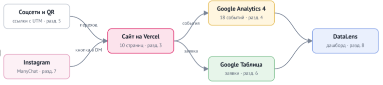
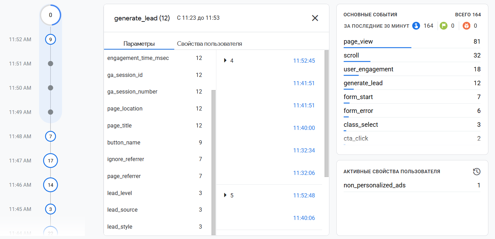
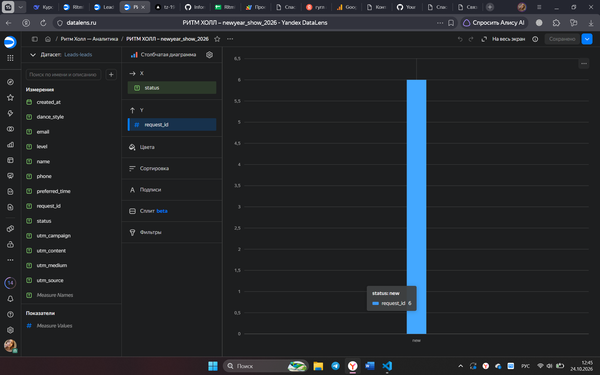

# Описание работы · ТЗ № 19 · «Сайт школы танцев, подбор направления, сквозная аналитика и запись на пробное занятие из социальных сетей.»

**Исполнитель:** Булаева Ева Игоревна, группа РПО/1, 2 курс
**Сайт:** https://tz-19-shkola-tancev-ritm-holl.vercel.app/
**Период проверок:** 18.10.2026 — 24.10.2026

## 1. Задача заказчика

Компания «Ритм Холл» получает заявки из Instagram и Telegram, но не знает, какой канал приводит клиентов, которые остаются заниматься. В сентябре 2026 года было 260 обращений, потеряно 213 (из 260 вопросов купили абонемент только 47). Задача — сайт, на котором видно источник каждого посетителя, и одна таблица со всеми заявками.

## 2. Схема работы

Посетитель приходит из соцсетей или по QR-коду по ссылке с UTM-метками.
Сайт отправляет события в GA4, а заявку — в Google Таблицу через Apps Script.
Данные GA4 и таблицы собираются на дашборде DataLens.

## 3. Сайт

Сайт из 11 страниц создан с помощью chatgpt и доработан вручную: добавлены data-атрибуты для аналитики, настроена адаптивность и форма записи. Опубликован на Vercel, обновляется после каждого push..
Опубликован на Vercel, обновляется после каждого push.

## 4. Аналитика GA4

Настроено 18 событий, из них своих — 12 (например, style_select, cta_click, generate_lead). Ключевые события: generate_lead, contact_click, messenger_click.
Каждое событие проверено в DebugView.

## 5. UTM-ссылки и соцсети

В реестре 12 ссылок, опубликованы в 1 соцсети (Instagram, ВКонтакте, Telegram,
YouTube), у двух партнёров и на афише с QR-кодом.

## 6. Заявки

Форма отправляет заявку в Apps Script, тот проверяет поля и записывает
строку в лист `leads` вместе с метками. Повторная отправка не создаёт дубль.

## 7. Автоответы в Instagram

Комментарий «___» под Reel запускает ответ в комментариях и сообщение
в Direct с кнопкой на сайт. Вторая ветка — слово «___».

## 8. Отчёты и дашборд

Воронка показала наибольшую потерю между page_view и cta_click (80%). Дашборд в DataLens подключен к Google Таблице и отображает заявки по статусам.

## 9. Что получил бизнес

| Было | Стало |
|---|---|
| заявки в личных сообщениях трёх аккаунтов | все заявки в одной таблице со статусом |
| источник клиента неизвестен | у каждой заявки есть source, medium, campaign |
| бюджет делится «по ощущениям» | на дашборде видно заявки по каждому каналу |
| ответы на комментарии вручную | ManyChat отвечает сразу и ведёт на сайт |

Рекомендация заказчику: ___ (по данным из раздела 8).

## 10. Итог

Не получилось: часть с инстаграмом.
